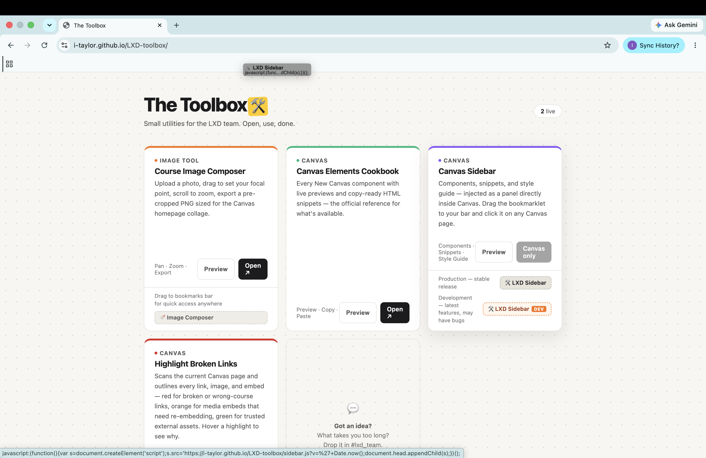
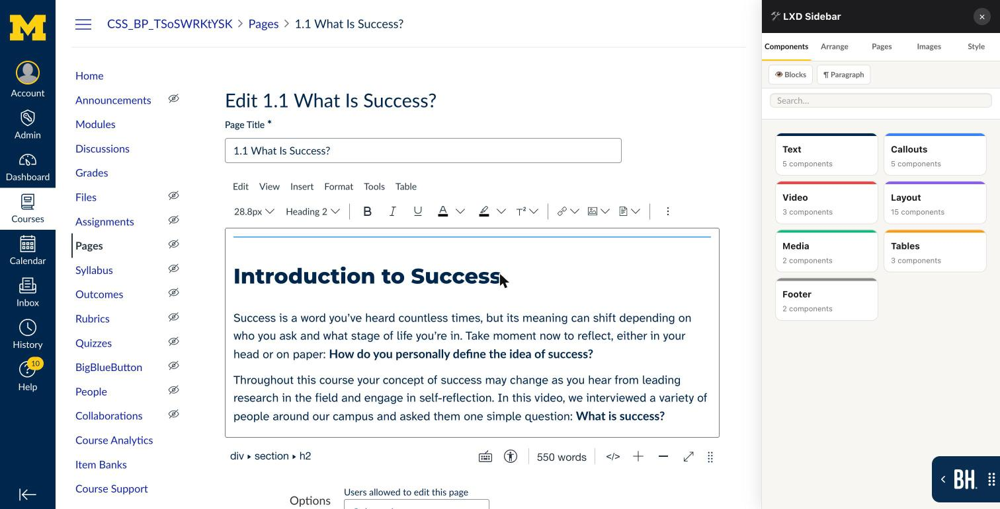
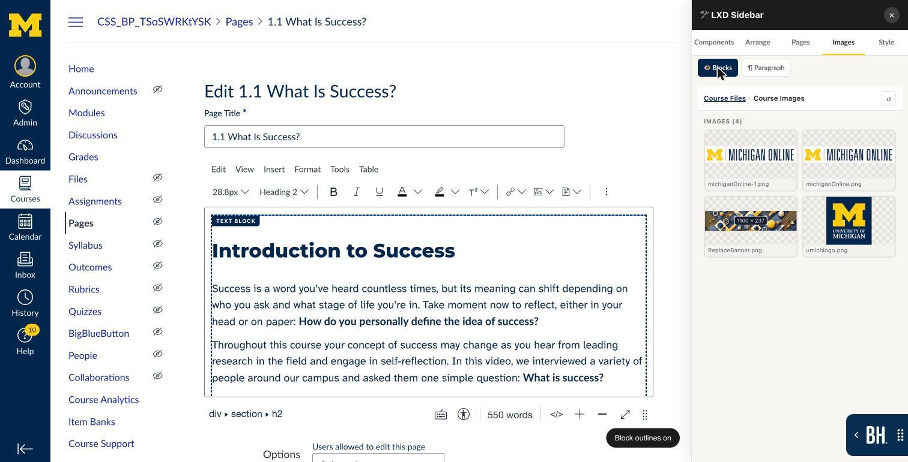
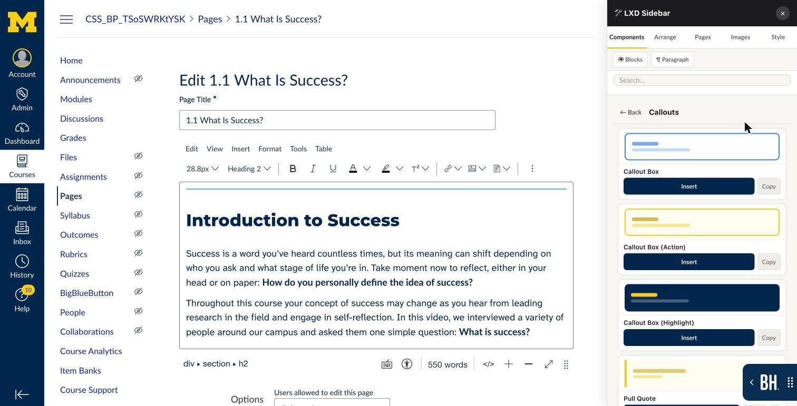
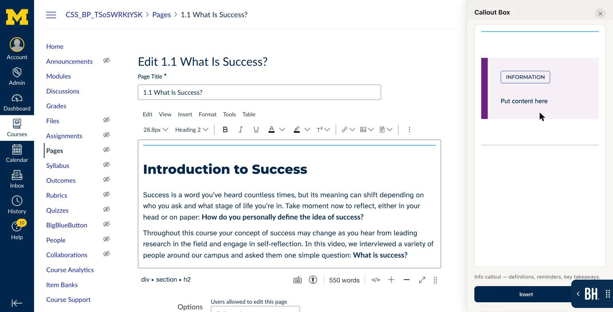
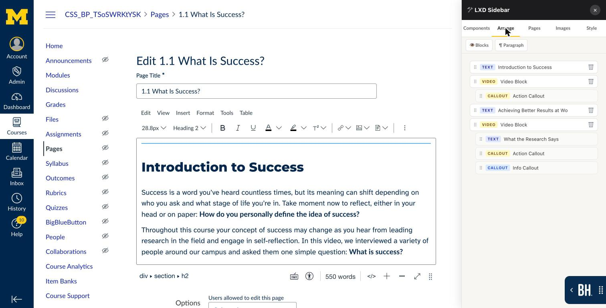
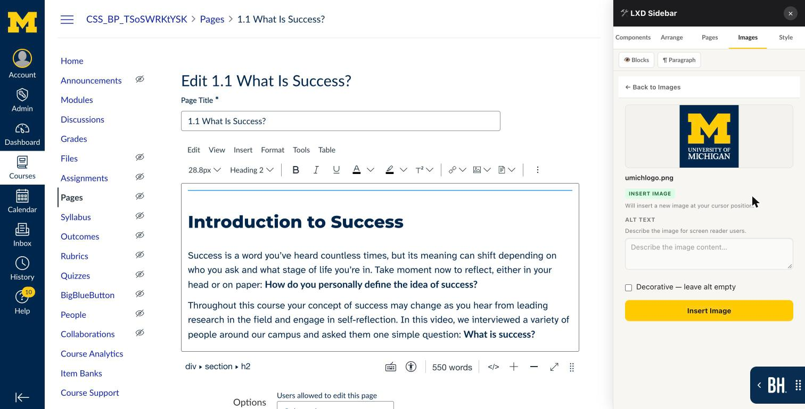
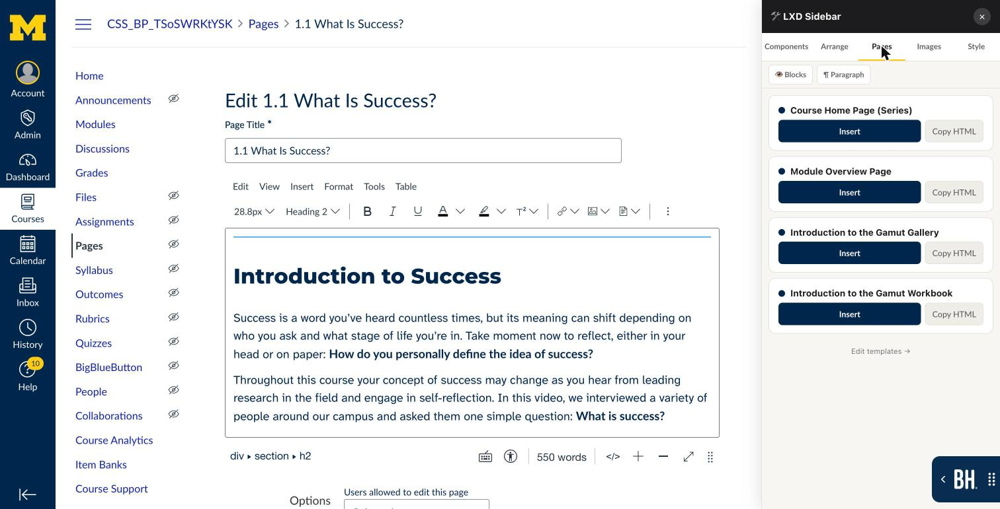
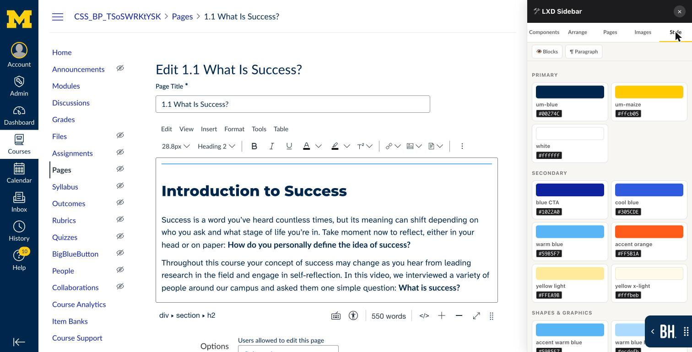

# Using the LXD Sidebar in Your Canvas Course

_Last updated: October 14, 2026_

The LXD Sidebar is a panel you open inside the Canvas page editor. It lets you add, rearrange and update course content without breaking the design the LXD team built. You install it once, in about two minutes, and it works in every course.

**Who this is for:** faculty updating a course after the LXD team has handed it over.

**What you need:**

- Google Chrome on a computer. The sidebar doesn't work on phones or tablets.
- Editing rights in the Canvas course (Teacher or Designer role).
- Chrome's bookmarks bar turned on.

## Part 1: Install the bookmarklet

The sidebar is installed as a bookmark that opens a tool instead of a website. This is called a bookmarklet. You install it once, and it updates itself from then on.

1. **Turn on the bookmarks bar in Chrome.** Press **Cmd+Shift+B** (Mac) or **Ctrl+Shift+B** (Windows), or go to **⋮ menu → Bookmarks and lists → Show bookmarks bar**.
2. **Open the LXD Toolbox page:** [i-taylor.github.io/LXD-toolbox](https://i-taylor.github.io/LXD-toolbox/).
3. **Find the LXD Sidebar card** and the row labelled **Production — stable release**.
4. **Drag the 🛠 LXD Sidebar button onto your bookmarks bar** and let go. A new bookmark called *🛠 LXD Sidebar* appears.
   - Use the **Production** button. Skip the one marked **Dev**: it's the LXD team's test version and may have bugs.
   - Clicking the button on the Toolbox page does nothing. It only works once it's dragged to the bar.
5. **Done.** You never need to reinstall it. Each click loads the newest version.

*Step 4: drag the Production button up to the bookmarks bar. The new LXD Sidebar bookmark appears where you drop it.*

## Part 2: Open the sidebar in Canvas

1. **Go to your course in Canvas** and open the **Page** you want to change.
2. **Click Edit** (top right of the page). The sidebar only works in the page editor.
3. **Click 🛠 LXD Sidebar on your bookmarks bar.** The panel slides in on the right, and the page moves left to make room.
4. **Make your changes** (see Part 3).
5. **Click Save** in Canvas as usual. The sidebar removes its own editing guides before the page saves, so students never see them.
6. **Close the sidebar** with the **×** in its header, or click the bookmark again.

*Step 3: the sidebar opens on the right, with the page editor still on the left.*

To make the panel wider or narrower, drag its left edge.

At the top of the panel are five tabs (**Components, Arrange, Pages, Images, Style**) and two buttons:

- **👁 Blocks** outlines each section of the page in the editor, so you can see where one ends and the next begins. The outlines are never saved.
- **¶ Paragraph** adds an empty paragraph where your cursor is. This helps when you can't click below a box to type.

*With Blocks on, each section gets a dashed outline and a label.*

## Part 3: Common tasks

### Add a new section (Components tab)

Components are ready-made, on-brand sections: text blocks, callout boxes, video sections, accordions, two-column layouts, tables and more.

1. **Click where the new section should go** in the editor, for example at the end of the section before it. If you don't click anywhere, the new section is added at the bottom of the page.
2. Open the **Components** tab and **pick a category** (Text, Callouts, Video, Layout, Media, Tables, Footer), or type in the **Search** box.
3. **Click a component's picture to preview** it. Some components, such as Accordion and Table, have settings here (for example, number of items or rows).
4. **Click Insert.** The section is added after the one your cursor is in.
   - A text component inserted inside a text block is added to that block instead of starting a new section.
5. **Replace the placeholder text and images** with your own.

*Step 2: a category lists its components, each with an Insert button.*

*Step 3: the preview shows the component before you insert it.*

### Move or delete a section (Arrange tab)

1. Open the **Arrange** tab. Each section of the page is listed in order, with a label such as TEXT, VIDEO or CALLOUT.
2. **Drag a row by its ⠿ handle** to a new position. The page updates right away.
3. To remove a section, **click 🗑** on its row and confirm.
4. Made a mistake? Press **Cmd+Z** (Mac) or **Ctrl+Z** (Windows) to undo.

*Each row is one section. Items set in slightly are inside the section above them.*

### Replace or add an image (Images tab)

The Images tab shows the images already uploaded to the course's **Files**. Upload a new image to Files first if you need to.

1. **To replace an image:** click the image on the page so it's selected. **To add a new one:** click where it should go.
2. Open the **Images** tab and **open folders** until you find the image. Click **↺** to refresh the list after uploading.
3. **Click the image.** The badge at the top says **Swap Image** (replacing the selected image) or **Insert Image** (adding a new one).
4. **Write alt text:** a short description of what the image shows, for screen-reader users. If the image is purely decorative, tick **Decorative** instead.
5. **Click Swap Image or Insert Image.** A swapped image keeps the original's size and position.

*Steps 3 to 5: write the alt text, then click the button. Here nothing was selected on the page, so the badge says Insert Image.*

### Start a page from a template (Pages tab)

The Pages tab holds full page layouts, such as the course home page and module overview.

1. Open a **new, empty page** in the editor.
2. Open the **Pages** tab and **click Insert** on a template.
   - If the page already has content, you'll be asked to confirm, because the template **replaces everything on the page**.
3. **Replace all bracketed placeholder text**, such as \[Course Name\] and \[Title\], and update the links.

*The Pages tab lists each template with an Insert button.*

### Match the course colours (Style tab)

1. Open the **Style** tab to see the Michigan Online colour palette.
2. **Click any colour swatch** to copy its hex code, for example #00274C (UM Blue). Paste it wherever Canvas asks for a colour.

*Click a swatch to copy its hex code.*

## Keeping the design intact

- **Add content with the sidebar, not copy and paste.** Text pasted from Word or another site brings its own formatting, which clashes with the course styles.
- **Edit text inside existing boxes.** Click into a callout or text block and type, rather than deleting it and starting again.
- **Always write alt text** for any image you add or swap, unless it's purely decorative.
- **Avoid the HTML editor (\</>)** unless you're comfortable with HTML. The course layout depends on specific code that's easy to break by accident.
- **Check Student View** after saving, so you see the page the way learners do.

## Troubleshooting

| Problem | Fix |
| --- | --- |
| Clicking the bookmark does nothing | Make sure you clicked **Edit** on the page first. The sidebar only works in the page editor. |
| The bookmark does nothing on the Toolbox page | That's expected. It only works on Canvas pages. |
| A component landed in the wrong place | Press Cmd+Z / Ctrl+Z, click inside the section it should follow, then insert again. Or drag it into place in the **Arrange** tab. |
| The Images tab shows Insert Image when you wanted Swap | Click the image on the page so it's selected, then click your new image again. |
| An image you just uploaded isn't listed | Click **↺** in the Images tab to refresh. |
| Pages says "Could not load templates" | Check your internet connection, then close and reopen the sidebar. |
| The page looks wrong after editing | Don't save. Press Cmd+Z / Ctrl+Z to undo, or click **Cancel** to discard your changes. |
